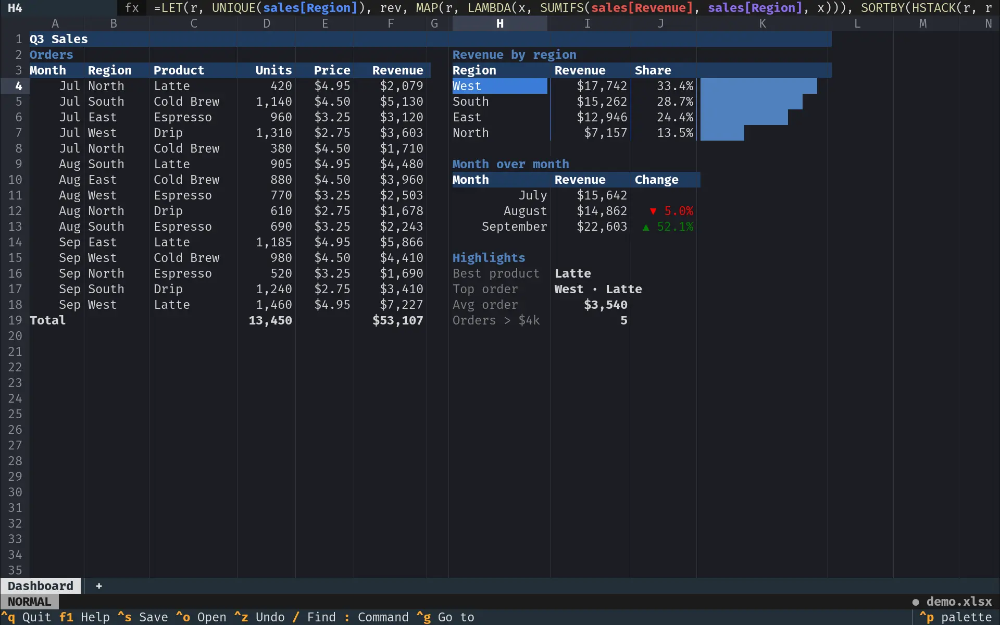

# tse

tse (terminal spreadsheet editor) is a spreadsheet for the terminal that is
mostly compatible with xlsx files.

```
tse budget.xlsx          # open a workbook
tse new.xlsx             # start a new one (created on first Ctrl+S)
tse data.csv             # CSV/TSV work too
tse --vi budget.xlsx     # vi-style keys
```

## About

- Should be compatible with most excel workbooks
- vi style keybindings (optional).
- Undo-tree style undo
- Reasonably fast
- Runs in the terminal

## Screenshot



## License

[Mozilla Public License 2.0](LICENSE)
